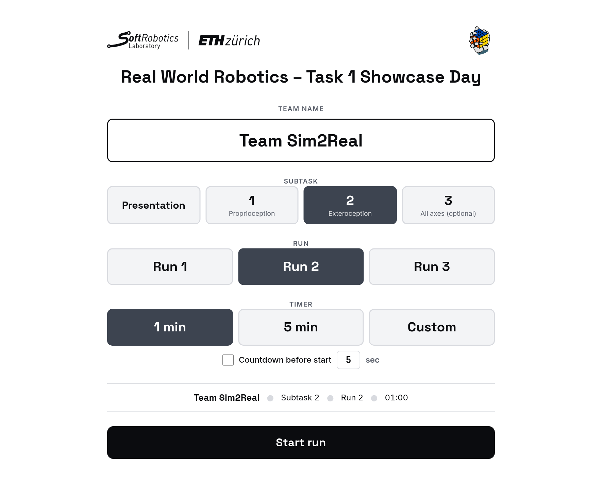
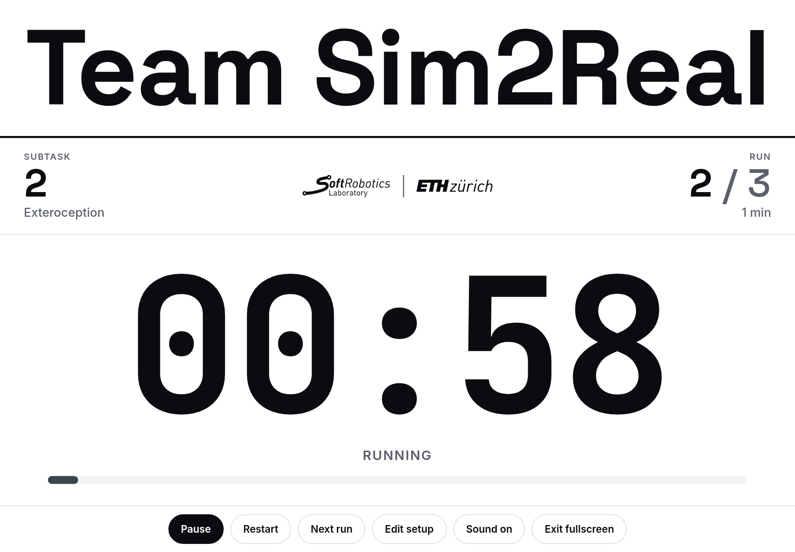

# RWR Showcase Timer

Full-screen run timer for the Real World Robotics Task 1 Showcase Day.

**Open:** https://vikashj21.github.io/rwr_timer/

<table>
  <tr>
    <th width="50%">Setup page</th>
    <th width="50%">Run page</th>
  </tr>
  <tr>
    <td align="center" valign="top"></td>
    <td align="center" valign="top"></td>
  </tr>
  <tr>
    <td align="center">Enter the team, subtask, run and timer</td>
    <td align="center">Team name, subtask, run and the countdown</td>
  </tr>
</table>

## How to use

1. Enter the team name.
2. Pick the subtask, run and timer. You can also tick 'Countdown before start'.
3. Press 'Start run'.

## Keys on the run page

| Key | Action |
|---|---|
| P | Pause / resume |
| R | Restart |
| N | Next run |
| E | Edit setup |
| F | Fullscreen |

A single static `index.html` with images in `assets/`. There is no build step.
